# ERD – Cơ sở tri thức DSS Thần số học (ASS3 · Pha 2.5) – BẢN CHỜ DUYỆT

DDL: `schema.sql` (51 bảng + 8 view). Đã chạy thử trên TiDB Cloud 8.5.3 ngày 02/11/2026 trong database tạm (đã xóa): 63/63 lệnh OK, 63 khóa ngoại được cưỡng chế, CHECK **không** cưỡng chế (`tidb_enable_check_constraint = 0`) → Node phải kiểm tra.

## Sơ đồ (rút gọn: chỉ khóa và quan hệ)

```mermaid
erDiagram
  %% ---- Tri thức nguồn (L5–L6)
  school ||--o{ calc_rule : "trường phái"
  school ||--o{ number_meaning : ""
  school ||--o{ signal_group : ""
  calc_rule ||--o{ formula : ""
  source_book ||--o{ citation : "trích dẫn"
  citation }o..|| calc_rule : "target"
  citation }o..|| number_meaning : "target"

  %% ---- Ánh xạ (L3)
  number_archetype_map }o--|| archetype : "10→1"
  number_meaning }o--o| archetype : ""
  archetype ||--|| skill : "SKxx"
  archetype ||--o{ profile_signal : "vị trí 1/2/3"
  major_profile ||--|{ profile_signal : "3 archetype"
  env_code ||--o{ major_profile : ""
  major_profile ||--o{ major : "300 ngành"
  major ||--o| admission_benchmark : "18 HaUI"
  major ||--o{ major_alias : ""

  %% ---- Mô hình (tham số có phiên bản)
  parameter_set ||--o{ persona_weight : "α β γ"
  parameter_set ||--o{ signal_weight : "w"
  parameter_set ||--o{ label_rule : ""
  parameter_set ||--o{ threshold : "xanh/vàng/đỏ"
  kpi ||--o{ threshold : ""
  decision_question ||--o{ kpi : "Q1–Q5"
  parameter_set ||--o{ sensitivity_result : ""

  %% ---- Người dùng & kết quả
  app_user ||--o| student : ""
  app_user ||--o| parent : ""
  app_user ||--o| counselor : ""
  student ||--o| student_context : "PII nhạy cảm"
  student ||--|{ student_skill : "12 KN"
  student ||--o{ student_exam : ""
  student ||--|{ student_signal : "G1..G6, SU"
  parent }o--|| student : "con"
  counselor ||--o{ counselor_assignment : ""
  student ||--o{ counselor_assignment : ""
  student ||--o{ run : ""
  parameter_set ||--o{ run : ""
  kb_release ||--o{ run : "ảnh chụp tri thức"
  run ||--|{ run_result : "35 hồ sơ"
  run ||--o{ run_warning : ""
  validity_rule ||--o{ run_warning : ""
  run_result ||--o{ explanation : "Vì sao?"
  explanation_template ||--o{ explanation : ""

  %% ---- Đánh giá & cộng tác
  usability_session ||--|{ usability_task : "3 nhiệm vụ"
  usability_session ||--|{ sus_answer : "10 câu"
  test_case ||--o{ usability_task : ""
  student ||--o{ comment : ""
  app_user ||--o{ comment : ""
```

## 5 nhóm bảng

| Nhóm | Bảng | Số dòng dự kiến sau ETL | Nguồn ETL |
|---|---|---|---|
| Tri thức nguồn | school, source_book, letter_mapping, calc_rule, formula, number_meaning, citation, glossary | 3 · 9 S + 13 E + 3 web · 26 + 3 · 20 · 25 · 29 · ~60 · ~70 | inventory: sources, letter_mapping, digraphs, calculation_rules, formulas, number_meanings; Phụ lục A |
| Ánh xạ | env_code, archetype, number_archetype_map, skill, major_profile, profile_signal, major, major_alias, admission_benchmark | 4 · 12 · 13 · 12 · 35 · 105 · 300 · tùy · 18 | archetypes, major_profiles, majors, admission_pilot |
| Mô hình | parameter_set, signal_group, signal_weight, persona_weight, label_rule, weekday_map, decision_question, kpi, threshold, validity_rule, kb_release, whatif_scenario, sensitivity_result, ref_document | 3 · 6 · 15 · 9 · 12 · 7 · 7 · 6 · ~24 · ~10 · 1 · 12 · 300×5×3 · ~90 | parameters, weight_sets, label_rules, weekday_map, kpi_chain, whatif_scenarios, data_gap, change_log… + chạy lại Sensitivity |
| Người dùng & kết quả | app_user, student, student_context, student_skill, student_exam, student_signal, parent, counselor, counselor_assignment, run, run_result, run_warning, explanation_template, explanation | 120 · 375 · 75 · 4.500 · 300 · 2.250 · 30 · 10 · 75 · … | students_300 + sim/people.json |
| Đánh giá | test_case, usability_session, usability_task, sus_answer, comment, audit_log | 18 · (test thật) | DSS_ASS3_GiaLap_120_nguoi.xlsx |

Truy vấn kiểm chứng sau ETL: 300 ngành · 35 hồ sơ · 105 profile_signal · 29 ý nghĩa số · 26 chữ + 3 chữ ghép · 12 archetype · 12 kỹ năng · 9 persona_weight · 120 app_user · 375 HS (300 + 75).

## Các quyết định thiết kế (cần nhóm duyệt)

1. **Tái lập kết quả đã lưu.** `parameter_set` có phiên bản: bản đã `active` không sửa, Admin sửa trên bản clone (`draft`) rồi kích hoạt. Tri thức ảnh hưởng tới điểm (35 hồ sơ, ngành → hồ sơ, bảng chữ, bảng thứ) được chụp vào `kb_release` (JSON + SHA-256). Mỗi `run` lưu `param_set_id + kb_release_id + options_json + weights_used + minmax_json` nên luôn tính lại được đúng kết quả cũ.
2. **Audit không cần trigger.** Node ghi `audit_log` trong cùng transaction với thay đổi (before/after JSON, lý do bắt buộc). `row_version` trên bảng tri thức để chống ghi đè đồng thời.
3. **Che dữ liệu (Ch6).** PII tách 2 lớp: `student.full_name/dob` chỉ trả cho chính HS, PH của HS, TVV được phân công; `student_context` (dân tộc, thu nhập, gia cảnh) chỉ Admin/TVV và chỉ hiển thị dạng nhóm. Màn hình tổng hợp dùng `v_student_masked` (tên viết tắt + năm sinh). `usability_session` chỉ lưu mã người tham gia.
4. **Một bảng `student` cho 2 bộ dữ liệu**: 300 HS ASS2 (`dataset = ASS2_300`, nguồn test hồi quy và Sensitivity) và 75 HS mô phỏng có tài khoản (`SIM_120`). `LIVE` dành cho người test thật nhập tay.
5. **Khóa chính**: bảng ghi nhiều (`run`, `audit_log`, `comment`, `usability_session`, `app_user`) dùng `BIGINT AUTO_RANDOM`. ID này vượt 2^53 → mysql2 bật `supportBigNumbers + bigNumberStrings`, API trả ID dạng chuỗi.
6. **`run_result` lưu đủ 35 dòng** (kể cả EC = 0) để tầng L4–L5 hiện bảng engine đầy đủ và để What-if so sánh trước/sau.
7. **Ngưỡng và cảnh báo nằm trong DB** (`threshold`, `validity_rule`) để Admin chỉnh mà không sửa code; engine đọc từ đó.
8. **Đổi tên so với PROMPT 2.5**: `profile_signal` = 3 archetype có thứ tự của hồ sơ; `number_archetype_map` = quy tắc số → archetype (10 → 1), còn 12 dòng Number_Archetype_Map vào bảng `archetype`. Thêm các bảng PROMPT chưa liệt kê nhưng web cần: `signal_group/signal_weight`, `label_rule`, `weekday_map`, `validity_rule`, `kb_release`, `sensitivity_result`, `admission_benchmark`, `student_context/exam`, `parent/counselor/assignment`, `run_warning`, `explanation_template`, `test_case`, `usability_task`, `glossary`, `ref_document`, `major_alias`.
